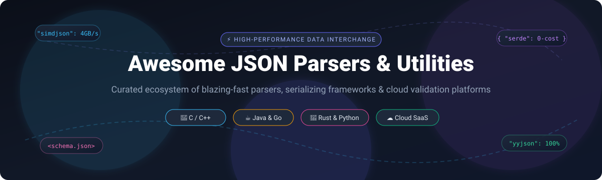

# ⚡ Awesome JSON Parsers & Utilities 🛠️

**Curated ecosystem of blazing-fast JSON parsers, high-throughput deserializers, language-native serialization frameworks, and cloud API validation tools.**

  
  
  
  
  
  

*Last updated: October 2026 • Curated for systems programmers, backend engineers, data platform architects, and API developers.*

---

## 📖 Table of Contents 📑

- [🎯 Sector Overview & Market Dynamics](#-sector-overview--market-dynamics)
- [☁️ SaaS & Hosted Platforms](#-saas--hosted-platforms)
- [💻 Open-Source GitHub Projects](#-open-source-github-projects)
  - [⚡ Top Open-Source JSON Libraries (Ranked by Stars)](#-top-open-source-json-libraries-ranked-by-stars)
- [🤝 How to Contribute](#-how-to-contribute)
- [💖 Support](#-support)
- [📈 Star History](#-star-history)
- [⚠️ Disclaimer](#️-disclaimer)

---

## 🎯 Sector Overview & Market Dynamics 📊

The global API management, data interchange, and schema validation tooling market is estimated at **$5.1 billion to $6.8 billion**, expanding rapidly at an estimated **28% CAGR** as microservice architectures, cloud-native pipelines, and AI agent payloads proliferate.

The sector is **moderately fragmented across layers**: foundational low-level parsing libraries are consolidated around language standard de-factos (such as Jackson in Java or Serde in Rust), while cloud-edge API mocking, JSON schema gateways, and transformation SaaS platforms remain competitive with no single winner-take-all monopoly.

---

## ☁️ SaaS & Hosted Platforms 🌐

While low-level parsing libraries run in-process within your application binaries, several cloud-hosted SaaS platforms provide hosted JSON validation, schema contract management, data transformation, and API mocking services:

| Platform | Description | Pricing (Starting Tier) | Free Tier Limits | Company Size (Valuation / Revenue) |
| :--- | :--- | :--- | :--- | :--- |
| **[Postman](https://www.postman.com/)** | Cloud-connected API workspace with built-in JSON schema validation, mock servers, and payload inspection. | $9/user/month (Solo plan, billed annually) or $19/user/month (Team plan) | Free forever for single user; includes 50 AI credits/mo, unlimited collection runs, mock server calls, and local executions (team collaboration restricted to paid plans). | $5.6B Valuation (Series D) / ~$313M ARR |
| **[Stoplight](https://stoplight.io/)** (SmartBear) | Cloud-first API contract design, JSON schema modeling, and Prism-powered mock servers. | $39/month (Starter tier covering up to 3 seats; additional users ~$8–$11/user/month) | Free forever Community plan: 1 cloud project and up to 3 workspace members (unlimited local desktop editor usage). | Parent SmartBear: ~$1.8B Valuation / ~$250M Revenue (Stoplight acquired in 2023; was ~$26M funding / ~$10M ARR) |
| **[Zuplo](https://zuplo.com/)** | Developer-focused API gateway offering JSON schema validation at the edge, request transformations, and rate limiting. | $25/month (Builder plan) | Free forever: Up to 100,000 requests/month, 2 developer seats, and 1 day of analytics/logs (no credit card required). | $13.5M Total Venture Funding (Seed) / Private early-stage ARR |
| **[WireMock Cloud](https://www.wiremock.io/)** | Cloud-hosted API simulation service supporting dynamic JSON response templating, payload validation, and chaos testing. | Enterprise / custom quote (Contact Sales for paid multi-user plans) | Free forever: 1,000 mock API calls/month, single user, 10 req/s rate limit, and up to 3 data sources. | $7.0M Venture Funding (Seed led by Ridge Ventures) / Private ARR |
| **[Beeceptor](https://beeceptor.com/)** | Zero-setup cloud mock server and webhook inspector with JSON schema matching, rules, and payload transformation. | $10/month (Individual plan; Team tier at $25/month) | Free forever: Unclaimed public endpoints expiring after 30 days (extended to 90 days if claimed), 1 MB payload size limit, ad-hoc HTTP debugging. | Bootstrapped / ~$45k–$50k Estimated ARR (~$4k MRR) |
| **[MockAPI](https://mockapi.io/)** | Hosted REST API and JSON mocking utility with built-in Faker.js generation and CRUD simulation. | $5/month (or $35/year for upgraded multi-project plan) | Free forever: Up to 1 project, 2 resources (endpoints) per project, basic CRUD support. | Bootstrapped / Micro-SaaS Private ARR |

---

## 💻 Open-Source GitHub Projects 🚀

The open-source ecosystem provides high-throughput, memory-efficient, and language-native JSON parsers. Below are the top open-source projects, equipped with live GitHub star badges and **sorted in descending order by star count**.

### ⚡ Top Open-Source JSON Libraries (Ranked by Stars) ⭐

1. **[nlohmann/json](https://github.com/nlohmann/json)**   
   **The ergonomic C++ standard.** The most widely adopted C++ modern JSON library with an intuitive STL-like interface. Supports seamless serialization macros (`NLOHMANN_DEFINE_TYPE_NON_INTRUSIVE`) and clean default fallback handling. Best for rapid modern C++ development and general-purpose backend services.

2. **[fastjson](https://github.com/alibaba/fastjson)**   
   **Alibaba's high-speed Java JSON processor.** Built for high throughput and low memory footprint in large Java application clusters.  
   > ⚠️ **Security Advisory**: Historical versions suffered from remote code execution vulnerabilities; ensure you run updated versions with `SafeMode` strictly enabled, or consider Jackson as a secure enterprise alternative.

3. **[simdjson](https://github.com/simdjson/simdjson)**   
   **The SIMD-accelerated throughput champion.** Parses JSON at gigabytes-per-second speeds (~4 GB/s) using SIMD CPU vector instructions (AVX2, AVX-512, ARM NEON). Offers on-demand DOM-free parsing for analytics pipelines and bulk stream ingestion.

4. **[Gson](https://github.com/google/gson)**   
   **Google's canonical Java JSON library.** Converts arbitrary Java objects into JSON representations without requiring source annotations. Highly ergonomic for Android and lightweight Java apps.  
   > ℹ️ **Status Note**: Currently in maintenance mode; recommended for stable, minimal-dependency Java applications.

5. **[gjson](https://github.com/tidwall/gjson)**   
   **Fastest one-line JSON value extractor for Go.** Provides blazing-fast JSON querying via expressive path syntax (e.g. `name.last`, `children.#`) without unpacking or unmarshaling documents into structs.

6. **[RapidJSON](https://github.com/Tencent/rapidjson)**   
   **Tencent's header-only fast C++ JSON parser.** Offers both SAX and DOM style APIs, SSE2/SSE4.2 vector optimizations, and zero external dependencies. Ideal for game engines and embedded systems requiring C++98/C++11 compatibility.

7. **[json-iterator/go](https://github.com/json-iterator/go)**   
   **High-performance drop-in replacement for standard library `encoding/json` in Go.** 100% compatible API with up to 6x speedup and significantly fewer memory allocations.

8. **[cJSON](https://github.com/DaveGamble/cJSON)**   
   **The ultra-lightweight ANSI C parser.** Implemented as a single C file and single header file with zero dependencies. The undisputed industry standard for microcontrollers, embedded IoT firmware, and robotics.

9. **[Jackson](https://github.com/FasterXML/jackson)**   
   **The standard Java enterprise data processor.** The default serialization engine for Spring Boot and cloud frameworks. Features a three-tier model: high-speed Streaming API, Tree Model (DOM), and full POJO Data Binding.

10. **[sonic](https://github.com/bytedance/sonic)**   
    **ByteDance's JIT & AVX-accelerated Go JSON parser.** Employs runtime just-in-time compilation and SIMD instructions to achieve the fastest end-to-end encoding/decoding throughput in large-scale Go microservices.

11. **[orjson](https://github.com/ijl/orjson)**   
    **The fastest Python library for JSON.** Written in Rust with native CPython bindings. Serializes dataclasses, datetimes, numpy arrays, and UUIDs natively at speeds far surpassing Python's built-in `json` and `ujson`.

12. **[Serde JSON](https://github.com/serde-rs/json)**   
    **The idiomatic Rust serialization benchmark.** Powered by Rust traits (`#[derive(Serialize, Deserialize)]`) to perform compile-time zero-copy serialization and deserialization without runtime reflection overhead.

13. **[yyjson](https://github.com/ibireme/yyjson)**   
    **The fastest ANSI C JSON library.** Passes 100% of JSON compliance suites with 0 false positives or negatives. Provides gigabyte-per-second parsing with portable C99 and zero third-party dependencies.

14. **[Oj](https://github.com/ohler55/oj)**   
    **Optimized JSON for Ruby.** Written as an optimized C extension with multiple compatibility modes (Strict, Object, Rails/ActiveSupport). The performance cornerstone for high-traffic Ruby on Rails APIs.

15. **[glaze](https://github.com/stephenberry/glaze)**   
    **Modern C++20 reflection-based JSON and binary serializer.** Rivals raw SIMD parse speeds (~2 GB/s) with extreme memory efficiency and zero boilerplate type mapping.

16. **[valyala/fastjson](https://github.com/valyala/fastjson)**   
    **Zero-allocation JSON parser for Go.** Engineered for high-load web servers and proxies that parse millions of concurrent JSON payloads without incurring garbage collector pauses.

17. **[ijson](https://github.com/ICRAR/ijson)**   
    **Iterative streaming JSON parser for Python.** SAX-style streaming interface that extracts fields from multi-gigabyte files with tiny, constant memory consumption.

---

## 🤝 How to Contribute 🛠️

Contributions from the developer community are warmly welcome!

1. 🍴 **Fork the repository** on GitHub.
2. 🌿 **Create a new branch** (`git checkout -b feature/awesome-json-tool`).
3. ✏️ **Add or update entries** in `README.md` keeping descriptions factual, concise, and adhering to table/star formatting.
4. 🚀 **Commit your changes** (`git commit -m "feat: add simd-json-tool"`).
5. 📬 **Push to your branch** and open a **Pull Request** detailing your additions.

---

## 💖 Support ⭐

If you found **Awesome JSON Parsers & Utilities** helpful, consider showing your support:

- 🌟 **Star this repository** on GitHub to help other engineers discover it!
- 🍴 **Fork & share** with teammates, communities, and tech socials.
- ☕ **Buy a coffee or sponsor ongoing maintenance** via the [GitHub Sponsor Dashboard](https://github.com/sponsors/ishandutta2007).

Thank you for powering open-source software and modern data interchange! 🙌

---

## 📈 Star History 🌟

---

## ⚠️ Disclaimer 📌

- This repository is a **community-curated educational resource**; listings do not represent formal commercial endorsements.
- **Performance benchmarks are hardware and payload dependent**: Real-world throughput varies significantly depending on depth, character escaping, array distribution, and CPU cache sizes. Run isolated micro-benchmarks on your own representative payloads.
- **Correctness and security take precedence**: Ensure parsers pass strict RFC 8259 validation suites and run on patched, secured runtime dependencies.

---

  Maintained with ❤️ by <a href="https://github.com/ishandutta2007">Ishan Dutta</a> and the open-source community.

